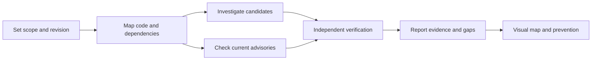

# Security Audit Skill

A security audit skill from Strataward. It connects code findings to evidence, checks current advisories, creates visual maps, and proposes controls to prevent repeat defects.

The repository is named `security-audit-skill`. The installed skill is named `agentassure-audit`.

## What it does

- Maps entry points, trust boundaries, and coverage.
- Assigns bounded investigations to agents when the host supports delegation.
- Uses a separate verifier to try to disprove each candidate.
- Checks public package versions through OSV and CISA KEV.
- Preserves older matching advisories while highlighting recent changes.
- Saves evidence, findings, rejected claims, and gaps across checkpoints.
- Creates an Archify HTML map when that separate skill is available.
- Proposes controls, regression tests, CI checks, and retest conditions.



## Install for your agent

Use the [Skills CLI](https://github.com/vercel-labs/skills). It requires Node.js 22.20 or later. Run this command from your project and select your agents:

```bash
npx skills add Strataward/security-audit-skill --skill agentassure-audit
```

Select Codex, Claude Code, and Cursor directly:

```bash
npx skills add Strataward/security-audit-skill --skill agentassure-audit -a codex -a claude-code -a cursor
```

Install for all agents supported by the CLI:

```bash
npx skills add Strataward/security-audit-skill --skill agentassure-audit --agent '*'
```

Add `-g` to any install command for use across projects. Omit it for a project install. Keep the wildcard quoted. Use `--copy` if your environment does not support symlinks.

Inspect available skills before installation:

```bash
npx skills add Strataward/security-audit-skill --list
```

Check and update an installed copy:

```bash
npx skills check
npx skills update agentassure-audit
```

See the [supported agent list](https://github.com/vercel-labs/skills/blob/main/docs/agents.md) for current targets. “All agents” means the agents supported by that installer. It does not mean that every host provides the same tools or execution controls.

## Use the skill

In Codex, use `$agentassure-audit`. In Claude Code or Cursor, select the installed skill through the host's skill interface, or ask:

```text
Use the agentassure-audit skill to audit this repository.
Check current CVEs.
Create a visual report and prevention plan.
```

The portable entry point is [SKILL.md](skills/agentassure-audit/SKILL.md). The `agents/openai.yaml` file supplies optional Codex UI metadata. Other agents can use the same instructions and Python helpers without that metadata.

For a host without installer support, copy the complete `skills/agentassure-audit` folder into its documented skills directory. Keep its references, scripts, and assets together. Do not replace an existing installation without reviewing the changes.

| Host capability | Behavior when unavailable |
|---|---|
| Independent subagents | Keep findings unconfirmed. A second pass by the same agent is not independent verification. |
| Live web access | Record current advisory checks as incomplete. |
| Python execution | Use source review and report that helper validation did not run. |
| Verified OS sandbox | Do not execute target code. Continue with static evidence. |
| Archify and its runtime | Produce the written report and a diagram draft. Mark HTML delivery incomplete. |

Installation compatibility does not establish audit quality. The helper tests run in CI. Full audit behavior has not been tested in every supported agent.

## Requirements and limits

The helper scripts use Python 3.11 or newer and the standard library. CI tests Python 3.11, 3.12, and 3.13. The agent provides source inspection, reasoning, delegation, and web tools.

Archify is optional and separate. Install the [Archify skill](https://github.com/tt-a1i/archify) to produce the interactive HTML map. Without it, the audit can produce a written report and a diagram draft. HTML delivery remains incomplete.

This repository does not provide a sandbox. Target code runs only when the agent can verify OS isolation, denied external network access, resource limits, and isolated scratch storage. Without those controls, the audit remains static. The trusted coordinator can fetch public advisory metadata outside target execution.

A package advisory match does not prove an exploitable application defect. The helper does not cover every ecosystem or fetch every vendor advisory. The skill requires source verification and records unavailable sources. It does not certify that a repository is secure.

This skill does not create scheduled monitoring. It does not apply fixes, change CI, probe production, or publish audit results without task authorization.

## Advisory helper

Create a reviewed JSON file with exact public package versions:

```json
{
  "recent_days": 30,
  "packages": [
    {"name": "lodash", "ecosystem": "npm", "version": "4.17.20", "public": true}
  ]
}
```

The package above is a lookup example. It is not a recommended version.

```bash
python3 skills/agentassure-audit/scripts/advisories.py packages.json --online --output advisories.json
```

Only entries marked `public: true` leave the machine. Keep unknown and private identities local. The output path must be new. Exit 0 means the helper lookups completed. Exit 2 means coverage is partial. Exit 1 means an input or write failure. None is a security verdict.

Read [advisory guidance](skills/agentassure-audit/references/advisories.md) for vendor checks, version applicability, aliases, and known exploitation.

## Evidence and visualization

Read [the record contract](skills/agentassure-audit/references/records.md) for evidence fields and checkpoint commands. The record helper checks references and source hashes. It does not prove the truth of a finding or enforce agent independence.

Read [visualization guidance](skills/agentassure-audit/references/visualization.md) for Archify delivery. The [example specification](skills/agentassure-audit/assets/audit-workflow.json) describes the audit process. It is not an audit of a project.

## Development

Run the offline helper tests:

```bash
python3 -m unittest discover -s skills/agentassure-audit/scripts -p 'test_*.py'
```

CI runs the same tests. It does not call advisory services, execute a target repository, or perform a security audit.

See [CONTRIBUTING.md](CONTRIBUTING.md) and [SECURITY.md](SECURITY.md).

## Attribution and license

The method follows [Cloudflare's security-audit-skill](https://github.com/cloudflare/security-audit-skill) and its published harness guidance. This is an independent Strataward project. It is not the Cloudflare repository and does not claim Cloudflare endorsement. It does not vendor Cloudflare prompt files or the Archify renderer.

See [source references](skills/agentassure-audit/references/sources.md). New code and instructions in this repository use the [MIT License](LICENSE).
