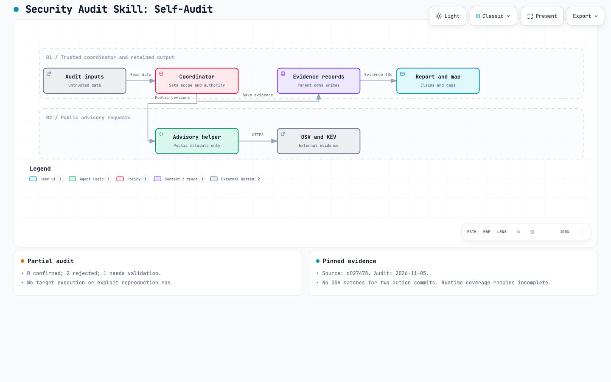

# Self-audit demo

This is a real, bounded use of `agentassure-audit` on its own repository. The result is **partial**: zero confirmed vulnerabilities, two rejected candidates, and one candidate that needs validation. This result is not a security certification.

Audited revision: [`c02747805f7dc563e4f534fbb4084c10a8273e29`](https://github.com/Strataward/security-audit-skill/tree/c02747805f7dc563e4f534fbb4084c10a8273e29). Audit date: 2026-11-05. The later documentation commit is outside this source snapshot.

[Download the interactive map](security-map.html). GitHub shows HTML as source. Download the file and open it locally to use the viewer. The map describes the repository's intended audit workflow from source instructions. It is not a runtime trace. The map shows documented paths. This run queried OSV directly from the trusted coordinator. KEV was not queried.

## What ran

- The coordinator inventoried the 19 tracked files and recorded their hashes.
- A separate source reviewer inspected both Python helpers and the execution policy.
- An independent verifier tried to disprove the candidate claims against the source.
- The trusted coordinator made two live OSV queries for the pinned GitHub Actions commits.
- The installed record helper checked source hashes, references, and map IDs.
- Archify generated the diagram from these records.

No target script, test, build, exploit, or package install ran during this audit. A verified OS sandbox was unavailable. Existing [CI results](https://github.com/Strataward/security-audit-skill/actions/runs/42085132817) passed at the audited commit. That is earlier test evidence, not a reproduction performed by this audit.

## Findings and rejected claims

| ID | Candidate | Verdict | Basis |
|---|---|---|---|
| `finding-proxy` | Environment proxy settings bypass the helper's empty proxy handler. | Rejected | The explicit `ProxyHandler({})` replaces the default handler. The request adds no proxy credentials. |
| `finding-failed-query` | Failed or skipped package queries leave the report complete. | Rejected | Failed requests carry an error and set partial. Private or unknown packages set partial. A successful empty response means no source match. |
| `finding-race` | A concurrent source file swap may bypass path checks before a file opens. | Needs validation | Path checks and file opening are separate operations. No practical attacker, race, or security effect was demonstrated. No severity is assigned. |

The relevant sources are [`advisories.py`](https://github.com/Strataward/security-audit-skill/blob/c02747805f7dc563e4f534fbb4084c10a8273e29/skills/agentassure-audit/scripts/advisories.py) and [`audit_records.py`](https://github.com/Strataward/security-audit-skill/blob/c02747805f7dc563e4f534fbb4084c10a8273e29/skills/agentassure-audit/scripts/audit_records.py). The verifier checked the [Python proxy-handler contract](https://docs.python.org/3/library/urllib.request.html) and the [OSV query contract](https://google.github.io/osv.dev/post-v1-query/).

A rejected candidate does not clear its entire attack class. Independent source review is not runtime verification.

## Current advisory checks

| Component | Exact identity | OSV result |
|---|---|---|
| actions/checkout | `11d5960a326750d5838078e36cf38b85af677262` | No match returned |
| actions/setup-python | `a26af69be951a213d495a4c3e4e4022e16d87065` | No match returned |

Queries completed at approximately 18:34 UTC on 2026-11-05. [advisories.json](advisories.json) preserves the requests' commit identities, retrieval times, and responses. The queries did not filter out older records. No CVE match was established, so KEV enrichment did not run. Known exploitation is not cleared.

The Python helpers import only the standard library. There is no third-party Python dependency manifest. Exact Python patch versions and the runner image are not pinned in this repository. Bundled action dependencies, Python vulnerabilities, and runner vulnerabilities remain outside the completed checks. The current vendor security pages for [checkout](https://github.com/actions/checkout/security) and [setup-python](https://github.com/actions/setup-python/security) showed no published advisories when reviewed. That does not establish complete dependency coverage.

## Prevention

The proposed control is a stable, immutable source snapshot during evidence collection. If hostile concurrent writers must be supported, consider descriptor-relative reads that refuse links. First test the candidate in an isolated synthetic tree. Assert that a concurrent swap cannot cause evidence to refer outside the target.

This control remains proposed. No helper change, regression test, or verified fix is claimed. The retained-output directory's single-writer rule does not by itself make the source tree immutable.

## Evidence and reproduction

- [audit.json](audit.json): coverage, findings, prevention, and evidence references.
- [snapshot-manifest.json](snapshot-manifest.json): hashes of the audited source files.
- [security-map.json](security-map.json): diagram specification.
- [visual-evidence.json](visual-evidence.json): element-to-evidence mapping.
- [VALIDATION.md](VALIDATION.md): artifact and browser check status.

The public record uses `target: "."` for portability. Source references are relative to the audited repository root. To recheck source hashes, use a clean checkout of the pinned revision and keep these demo files outside that checkout. Use a separately trusted copy of the record validator. Current README bytes will differ because this demo was added after the audited revision.

This is a self-audit by agents in one session. It is not an external assessment. The documented constraints remain visible so readers can distinguish successful checks from missing evidence.
